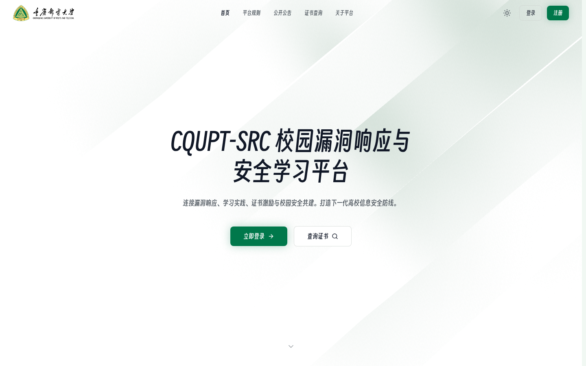
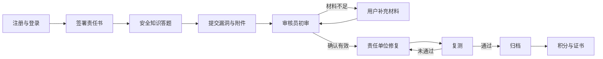
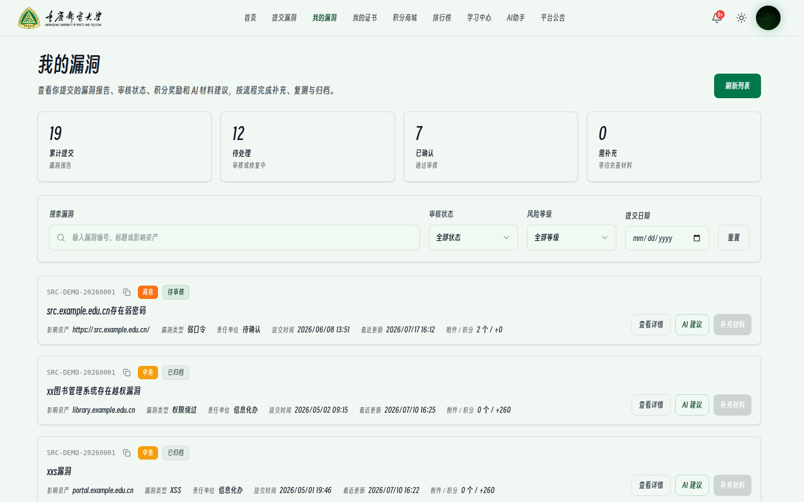
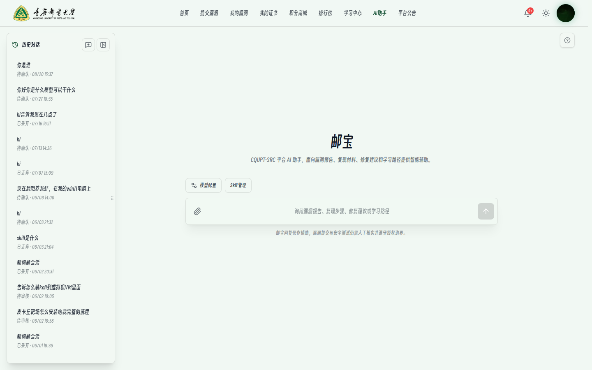
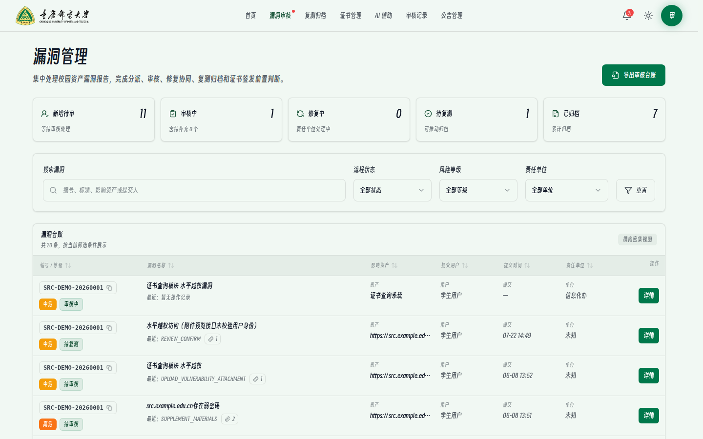
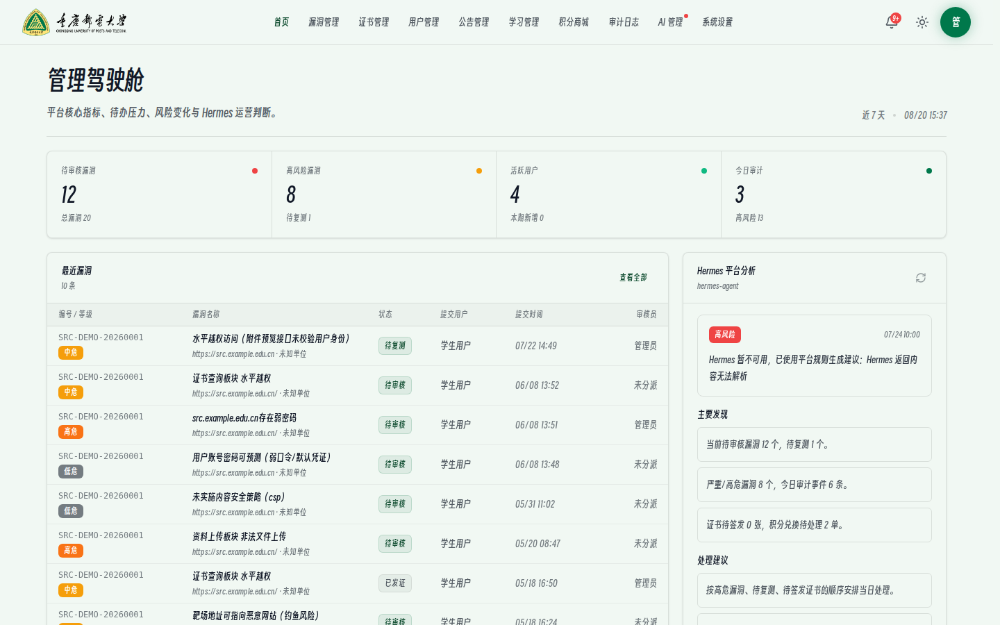
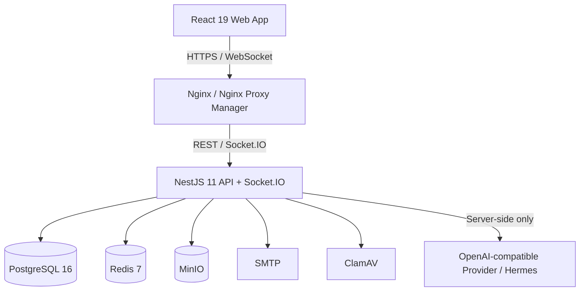

<p align="center">
  <picture>
    <source media="(prefers-color-scheme: dark)" srcset="./CQUPT/CQUPT_03_logo_dark.png">
    <source media="(prefers-color-scheme: light)" srcset="./CQUPT/CQUPT_03_logo.png">
    
  </picture>
</p>

<h1 align="center">CQUPT-SRC</h1>

<p align="center">
  校园漏洞响应与安全学习平台
  <br>
  连接漏洞提交、审核协同、修复复测、贡献激励与安全知识复用。
</p>

<p align="center">
  
  
  
  
  
</p>

<p align="center">
  <a href="#核心能力">核心能力</a> ·
  <a href="#平台工作流">平台工作流</a> ·
  <a href="#界面预览">界面预览</a> ·
  <a href="#系统架构">系统架构</a> ·
  <a href="#快速开始">快速开始</a> ·
  <a href="#项目文档">项目文档</a>
</p>



<!-- CQUPT-SRC-DOCS-SYNC:START -->
> 文档状态：本 README 于 2026-08-20 按当前 `main` 分支的代码、Prisma Schema、环境变量示例和本地运行结果重新整理。历史设计文档可能记录过渡方案；发生冲突时，以当前代码、数据库迁移和接口行为为准。
<!-- CQUPT-SRC-DOCS-SYNC:END -->

## 项目定位

CQUPT-SRC 面向校园网络安全治理场景，将学生或白帽用户、审核员和平台管理员连接到同一套可追踪流程中。平台不只接收漏洞报告，还负责提交前安全准入、材料补充、审核与修复协同、复测归档、证书与积分激励、通知触达、学习资源和 AI 辅助。

平台的目标是让一次校园漏洞报告具备清晰的责任边界、稳定的处理状态、完整的审计记录和可复用的安全知识，同时避免 AI 越权替代人工审核。

> 当前仓库处于持续开发阶段。用于生产环境前，必须完成独立安全评审、密钥轮换、邮件与对象存储配置、恶意文件扫描和备份恢复演练。

## 核心能力

| 能力 | 说明 |
|---|---|
| 漏洞全生命周期 | 提交、材料补充、审核、责任单位协同、修复、复测、归档和状态追踪形成闭环。 |
| 安全准入 | 用户提交漏洞前完成网络安全责任书签署与知识答题；题库、通过分数和责任书由管理员维护。 |
| 报告与附件 | 支持漏洞报告附件上传、受控预览、补充材料和操作留痕；生产环境可接入 ClamAV 扫描。 |
| 审核工作台 | 审核员集中处理待审、待补充、修复中和待复测报告，并形成审核记录。 |
| 证书与激励 | 已归档贡献可关联积分与证书；访客可通过公开页面核验证书真伪。 |
| 学习与社区 | 提供学习资源、积分商城、全校排行榜、平台公告、通知中心和受控即时聊天。 |
| 邮宝 AI 助手 | 通过后端 AI Gateway 提供平台问答、报告分析、可编辑提交卡片、Skills 和历史会话。 |
| AI 知识库 | 对已解决且具有复用价值的会话进行脱敏、总结、聚类、审核和检索，命中时标注知识来源。 |
| 模型配置 | 管理员配置平台模型；用户可在策略允许时配置 OpenAI-compatible 模型供应商与多个凭据。 |
| 平台治理 | RBAC、用户管理、公告、系统外观、题库、AI 管理、审计日志和运营驾驶舱集中配置。 |

## 角色与边界

| 角色 | 主要能力 | 关键限制 |
|---|---|---|
| 用户 | 完成安全准入、提交与跟踪漏洞、补充材料、查看证书和积分、使用学习资源与 AI 助手 | 只能访问自己的敏感业务数据，不能执行审核或平台管理操作 |
| 审核员 | 审阅报告、要求补充、协同修复与复测、管理证书相关流程、查看审核记录 | AI 只提供辅助建议，审核结论仍由人工确认 |
| 管理员 | 管理用户、权限、系统设置、题库、公告、积分商城、AI、知识库和审计 | 高风险操作必须经过后端权限校验并写入审计日志 |
| 访客 | 阅读平台规则与公告、查询证书、进入登录注册流程 | 不可访问内部业务和用户数据 |

## 平台工作流



重要状态变化通过站内通知触达；要求补充、审核驳回、确认有效、归档和证书签发等关键事件可进入邮件通知链路。通知读取状态同时驱动顶部铃铛和对应业务菜单的未读提示。

## 界面预览

以下截图来自本地演示环境，页面中的账号、域名、编号和漏洞内容均为演示数据。

### 用户漏洞工作台

用户可以按编号、标题、资产、状态、等级和提交日期检索自己的报告，并从同一列表查看详情、获取 AI 建议或补充材料。



### 邮宝 AI 助手

AI 助手提供历史会话、模型配置、声明式 Skill、附件分析和结构化回复。平台业务数据由后端按当前用户权限注入，前端不直接持有平台模型密钥。



### 审核员漏洞管理

审核员使用统一队列筛选待审、修复中和待复测报告，并在详情流程中完成判断、补充要求和复测记录。



### 管理驾驶舱

管理员首页聚合待审核、高风险漏洞、活跃用户、审计事件和平台分析，面向日常运营而非单纯数据展示。



## AI 能力边界

邮宝不是可以绕过平台权限的通用 Agent。所有平台 AI 请求必须经过 NestJS AI Gateway：

1. 身份、角色和权限以 JWT 与后端 RBAC 为准，模型输出不能改变授权结果。
2. 积分、库存、漏洞状态和证书状态等实时数据由业务服务查询，知识库不替代实时数据源。
3. 附件文本在后端提取并按规则脱敏后再进入模型上下文；无法可靠脱敏的字段不发送给模型。
4. AI 可以生成报告建议和可编辑草稿，但漏洞有效性、风险等级、审核、归档和证书签发由人工或确定性业务规则决定。
5. 已解决会话只有在具备复用价值时才进入知识沉淀流程；用户来源知识不会自动转换为 Skill。
6. 模型调用、知识命中、用户反馈和管理操作均保留审计所需的结构化记录。

平台兼容 OpenAI-compatible API。Hermes Agent 可以作为模型与 Agent 网关使用，但前端始终只访问 CQUPT-SRC 后端，不直接连接 Hermes 或第三方模型服务。

## 系统架构



### 技术栈

| 层级 | 主要技术 |
|---|---|
| Web | React 19、TypeScript 5.9、Vite 6、Tailwind CSS 4、Motion、Three.js、React Three Fiber |
| API | NestJS 11、Express、Socket.IO、Node.js 原生 Fetch |
| 数据 | PostgreSQL 16、Prisma 6、Redis 7 |
| 文件 | MinIO、pdf-lib、pdf-parse、可选 ClamAV |
| 认证与安全 | Access/Refresh JWT、RBAC、ALTCHA、AES-GCM 凭据加密、审计日志 |
| AI | NestJS AI Gateway、OpenAI-compatible Provider、声明式 Skills、AI Knowledge Base |
| 工程化 | Docker Compose、Nginx、ESLint、Playwright、自定义 API/E2E 测试 |

## 项目结构

```text
.
├── frontend/             # React 单页应用、组件、页面和 Playwright 配置
├── backend/              # NestJS API、Socket.IO、业务模块与 Prisma Client
├── database/             # Prisma Schema、迁移、seed 与数据库文档
├── retest-runner/        # 受约束的复测执行器
├── retest-egress-proxy/  # 复测出网控制代理
├── deploy/               # Docker、Nginx、Hermes 与部署脚本
├── docs/                 # 架构、AI、安全、API、部署和实施文档
├── tests/                # API、E2E 与测试夹具
├── CQUPT/                # 平台品牌资源
├── resource/             # 模板等业务资源
├── start-local.sh        # Linux / WSL / macOS 本地启动入口
└── stop-local.sh         # 本地服务停止入口
```

## 快速开始

### 环境要求

- Node.js 22 LTS 或兼容版本
- npm
- Docker 与 Docker Compose v2
- Git、curl、OpenSSL

### 1. 获取代码

```bash
git clone https://github.com/Zonora-Wu/cqupt-src-2.10.git
cd cqupt-src-2.10
```

### 2. 创建本地配置

```bash
cp backend/.env.example backend/.env
cp frontend/.env.example frontend/.env
```

至少替换以下后端密钥。四个命令应分别执行，并将结果写入对应变量；Access 与 Refresh 密钥不能相同。

```bash
openssl rand -hex 32       # JWT_ACCESS_SECRET
openssl rand -hex 32       # JWT_REFRESH_SECRET
openssl rand -hex 32       # ALTCHA_HMAC_SECRET
openssl rand -base64 32    # AI_CREDENTIAL_ENCRYPTION_KEY
```

本地开发还应将 `PUBLIC_SITE_URL` 设为 `http://localhost:5173`。未配置模型服务时，非 AI 功能仍可开发；AI 请求会进入明确的不可用或降级状态。

### 3. 启动平台

```bash
bash start-local.sh
```

启动脚本会按需安装前后端依赖，启动 PostgreSQL、Redis 和 MinIO，生成 Prisma Client，执行迁移与 seed，然后启动前后端开发服务器。

| 服务 | 地址 |
|---|---|
| 前端 | http://localhost:5173 |
| 后端健康检查 | http://localhost:3001/api/health |
| MinIO 控制台 | http://localhost:9001 |
| PostgreSQL | `127.0.0.1:15432` |

本地 seed 演示账号仅用于开发环境：

| 角色 | 统一认证码 | 密码 |
|---|---|---|
| 用户 | `2025001` | `123456+-` |
| 审核员 | `0000001` | `auditor123456+-` |
| 管理员 | `0000000` | `admin123456+-` |

> 不要在公网环境保留 seed 账号、示例密码或 `.env.example` 中的默认基础设施凭据。

### 4. 停止平台

```bash
bash stop-local.sh
```

启动和停止脚本的运行日志位于 `tmp/logs/`。启动脚本支持跳过 PostgreSQL、Redis、MinIO 或数据库初始化，具体选项见脚本头部说明。

## 关键配置

| 变量 | 用途 | 生产要求 |
|---|---|---|
| `DATABASE_URL` | PostgreSQL 连接 | 使用独立账号、强密码和受限网络 |
| `JWT_ACCESS_SECRET` / `JWT_REFRESH_SECRET` | 签发访问与刷新令牌 | 至少 32 字节、互不相同、禁止提交仓库 |
| `ALTCHA_HMAC_SECRET` | 签发与校验人机验证挑战 | 使用独立随机密钥 |
| `REDIS_URL` | 缓存、锁与实时功能辅助 | 仅内网访问并配置持久化策略 |
| `MINIO_*` | 漏洞附件与证书对象存储 | 独立凭据、私有 Bucket、备份与生命周期策略 |
| `SMTP_*` | 验证码和重要业务邮件 | 使用专用发信账号并检查送达率 |
| `AI_CREDENTIAL_ENCRYPTION_KEY` | 加密数据库中的模型 API Key | 32 字节 Base64 或 64 位十六进制值，必须备份且限制读取 |
| `OPENAI_BASE_URL` / `OPENAI_API_KEY` / `OPENAI_MODEL` | 平台默认 AI 模型 | 只在后端配置，不得暴露到 `VITE_*` |
| `MALWARE_SCAN_*` / `CLAMAV_*` | 上传文件恶意内容扫描 | 生产环境建议强制启用并采用失败关闭策略 |
| `FRONTEND_ORIGIN` / `PUBLIC_SITE_URL` | CORS 与公开站点来源绑定 | 设置为实际 HTTPS 域名 |

完整字段和开发默认值见 [`backend/.env.example`](./backend/.env.example) 与 [`frontend/.env.example`](./frontend/.env.example)。生产部署步骤见 [`docs/deployment/README.md`](./docs/deployment/README.md)。

## 开发与验证

前后端是两个独立的 npm 工程。

```bash
# 前端
cd frontend
npm run lint
npm run build
npm run test:performance-budget
npm run test:e2e

# 后端
cd ../backend
npm run typecheck
npm run build
npm run test:security
npm run test:chat
npm run test:ai-knowledge
```

部分 API/E2E 测试要求本地数据库、对象存储和后端服务已启动。可按变更范围继续运行：

```bash
cd backend
npm run test:core-api
npm run test:core-e2e
npm run test:ai-problem-session
```

数据库变更必须通过 Prisma 迁移交付：

```bash
cd backend
npm run prisma:validate
npm run prisma:generate
npm run prisma:migrate:deploy
```

## 项目文档

| 文档 | 内容 |
|---|---|
| [`docs/PROJECT_STRUCTURE.md`](./docs/PROJECT_STRUCTURE.md) | 仓库结构与主要入口 |
| [`docs/TECH_STACK.md`](./docs/TECH_STACK.md) | 技术栈与工程约束 |
| [`docs/api/README.md`](./docs/api/README.md) | REST API 与接口分组 |
| [`database/DATABASE_DESIGN.md`](./database/DATABASE_DESIGN.md) | 数据库模型和业务关系 |
| [`docs/AI.md`](./docs/AI.md) | AI Gateway、上下文、权限和降级策略 |
| [`docs/AI_KNOWLEDGE_BASE.md`](./docs/AI_KNOWLEDGE_BASE.md) | 知识沉淀、检索、审核和维护 |
| [`docs/AI_SKILLS.md`](./docs/AI_SKILLS.md) | 系统 Skill 与用户声明式 Skill 设计 |
| [`docs/HERMES_RUNTIME.md`](./docs/HERMES_RUNTIME.md) | Hermes 兼容运行时与运维说明 |
| [`docs/security/README.md`](./docs/security/README.md) | 安全控制、密钥和上线检查 |
| [`docs/deployment/README.md`](./docs/deployment/README.md) | Ubuntu、Nginx 与生产部署说明 |

## 安全说明

- 不要提交 `.env`、模型 API Key、JWT 密钥、SMTP 凭据、真实漏洞附件或数据库备份。
- 上传文件、AI 上下文、聊天记录和审计导出都可能包含敏感信息，应遵循最小权限和最短保留原则。
- 公开截图、Issue 和日志必须先移除姓名、统一认证码、邮箱、真实资产、漏洞细节、令牌和请求头。
- 发现安全问题时，不要在公开 Issue 中披露利用细节；请通过项目维护方指定的私密渠道报告。当前公开安全联系地址未确认。

## 许可

仓库根目录当前未提供统一的开源许可证。外部使用、修改和分发权限因此未确认；在补充明确许可证前，请勿默认本项目可以被自由复制或商用。`backend/src/modules/ai/runtime-derived/` 下的第三方衍生代码应分别遵循其目录内许可证。
